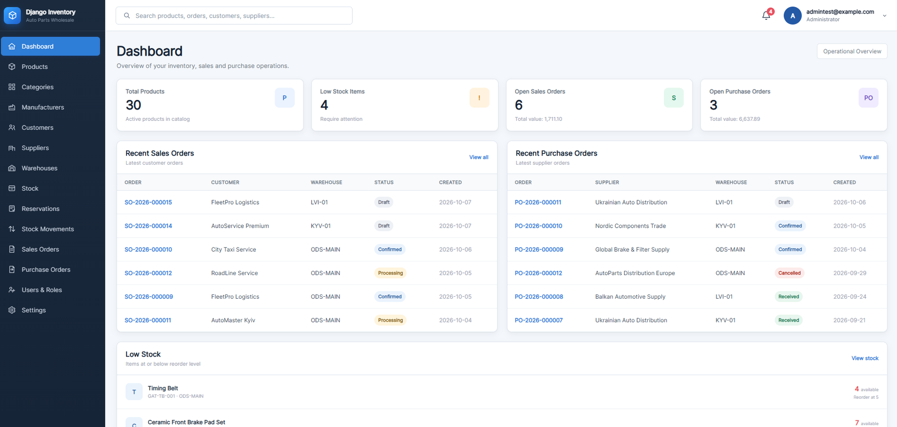
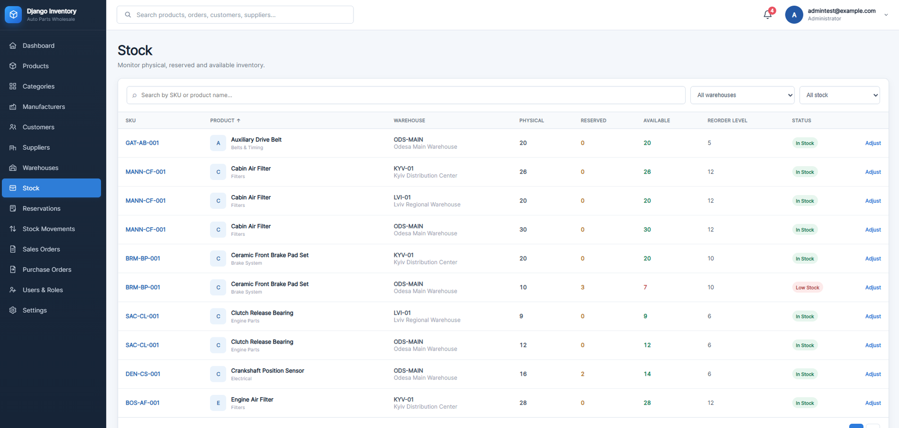
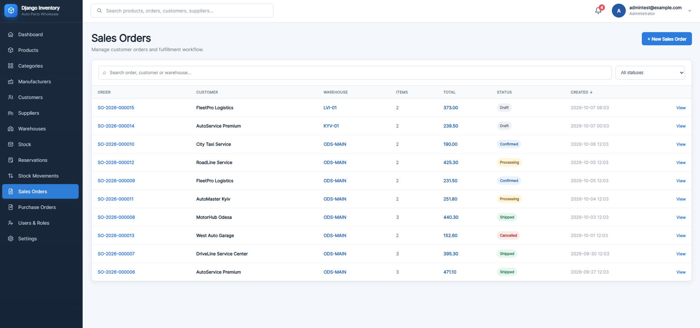
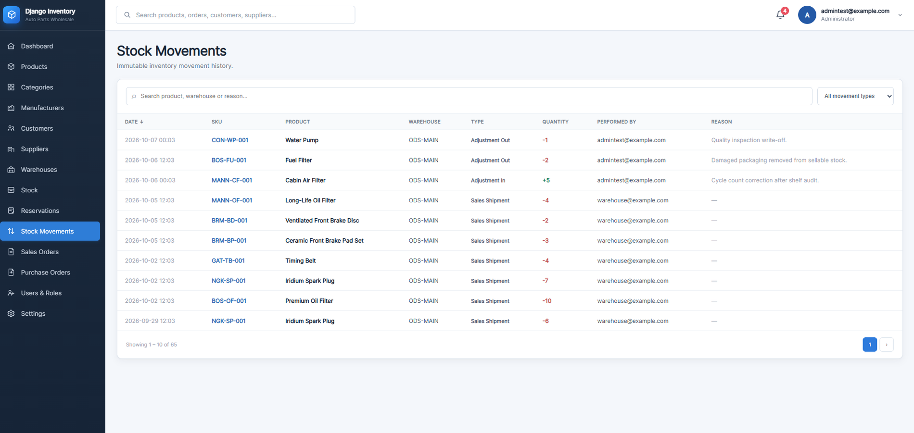

# Inventory & Order Management System

A portfolio project built with Django that demonstrates a complete inventory and order management workflow for a wholesale auto-parts business.

The application combines a server-rendered web interface with a REST API and includes multi-warehouse stock management, sales and purchase order lifecycles, stock reservations, stock movements, notifications, role-based access control, demo data generation, automated tests, and CI.

## Live Demo

The application is deployed and available online.

**[🌐 Open Live Demo](https://issuetracker.eugene-dev-hub.space/)**

> Demo accounts and login credentials are available on the [portfolio website](https://eugene-dev-hub.space/).

## Key Features

- Product catalog with categories, manufacturers, SKU and pricing
- Customers and suppliers
- Multiple warehouses
- Physical, reserved and available stock
- Low-stock monitoring and reorder levels
- Sales order lifecycle: `DRAFT → CONFIRMED → PROCESSING → SHIPPED`
- Purchase order lifecycle: `DRAFT → CONFIRMED → RECEIVED`
- Stock reservations: `ACTIVE`, `RELEASED`, `CONSUMED`
- Stock movement history
- Manual stock adjustments with reasons
- Role-based access control
- Internal notifications
- Global search
- Dashboard with operational metrics
- Configurable system settings
- REST API with JWT authentication
- Swagger / OpenAPI documentation
- Demo dataset management command
- Automated tests and GitHub Actions CI

## Screenshots

### Dashboard



### Stock & Low Stock



### Sales Order



### Stock Movements



## Tech Stack

**Backend:** Python 3.14, Django 5.2, Django REST Framework, Simple JWT, PostgreSQL 18

**Frontend:** Django Templates, HTMX, Alpine.js, HTML, CSS, JavaScript

**Infrastructure:** Docker, Docker Compose, GitHub Actions

## Quick Start

```bash
git clone https://github.com/Eugene-Plitka/django-inventory-order-management.git
cd django-inventory-order-management
```

Copy `.env.example` to `.env`, configure the environment variables, then run:

```bash
docker compose up -d --build
docker compose exec web python manage.py migrate
docker compose exec web python manage.py setup_roles
docker compose exec web python manage.py createsuperuser
```

Open:

```text
http://localhost:8000/
```

Swagger API documentation:

```text
http://localhost:8000/api/docs/
```

For complete installation instructions, role descriptions, business workflows, API notes, demo data setup, testing and project architecture, see:

[**Project Guide**](docs/PROJECT_GUIDE.md)

## Demo Dataset

The project includes a demo data generator:

```bash
docker compose exec web python manage.py seed_demo_data --reset
```

The command creates a complete demonstration environment with products, manufacturers, suppliers, customers, warehouses, purchase orders, sales orders, reservations, stock movements, notifications and low-stock scenarios.

> `--reset` deletes existing business data. Users, groups, roles and system settings are preserved.

## License

This project is intended to be distributed under the MIT License.

See the [`LICENSE`](LICENSE) file for the full license text.
